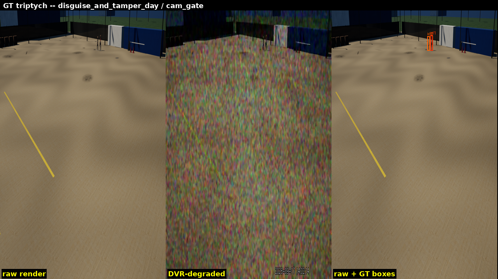
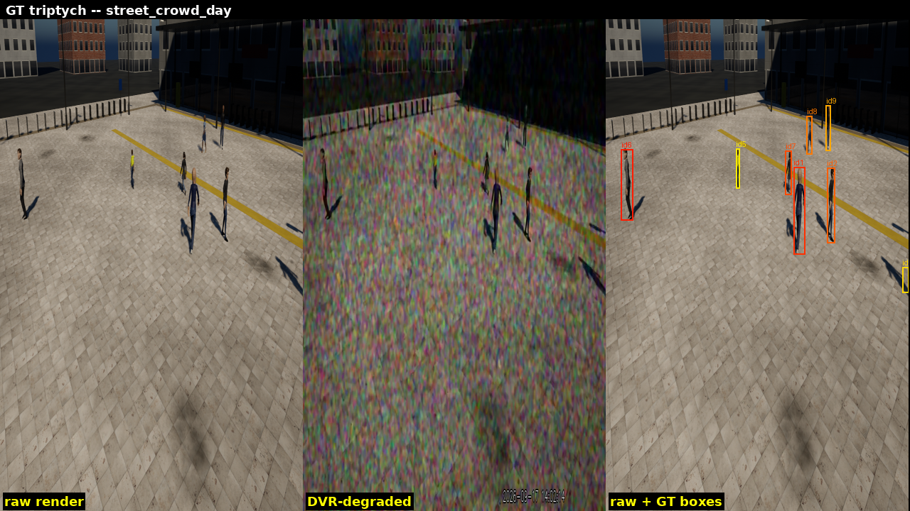
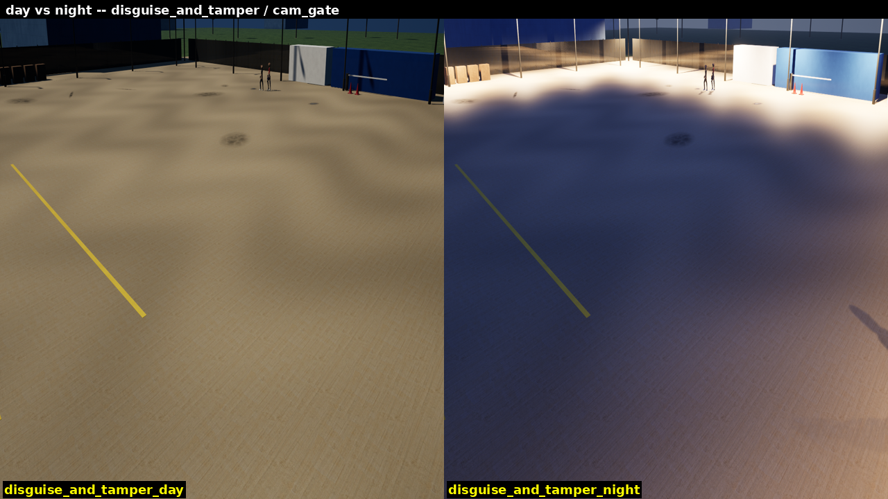
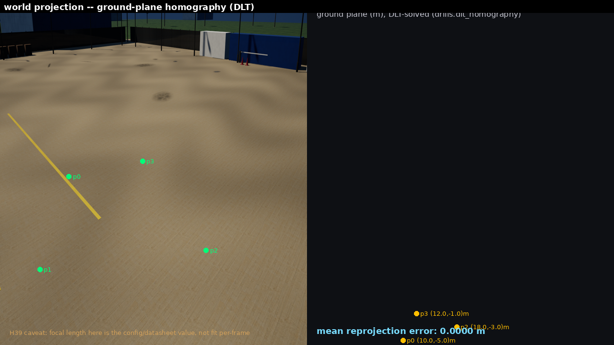
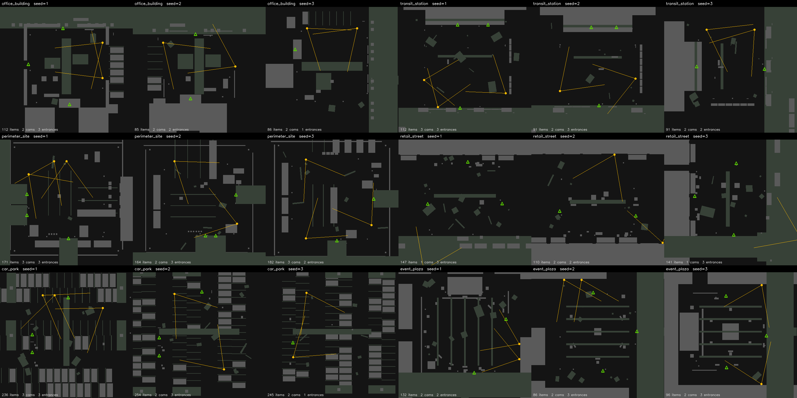
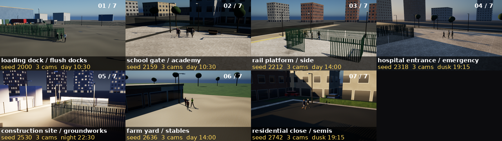
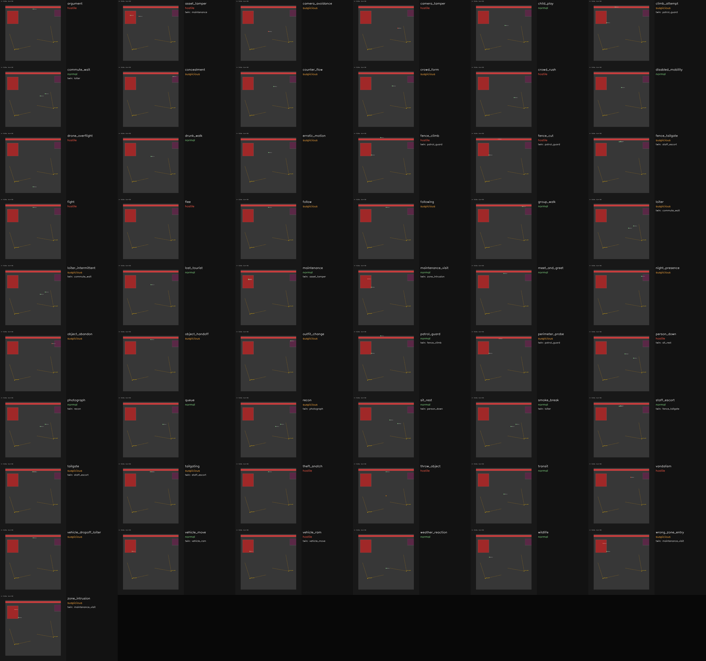
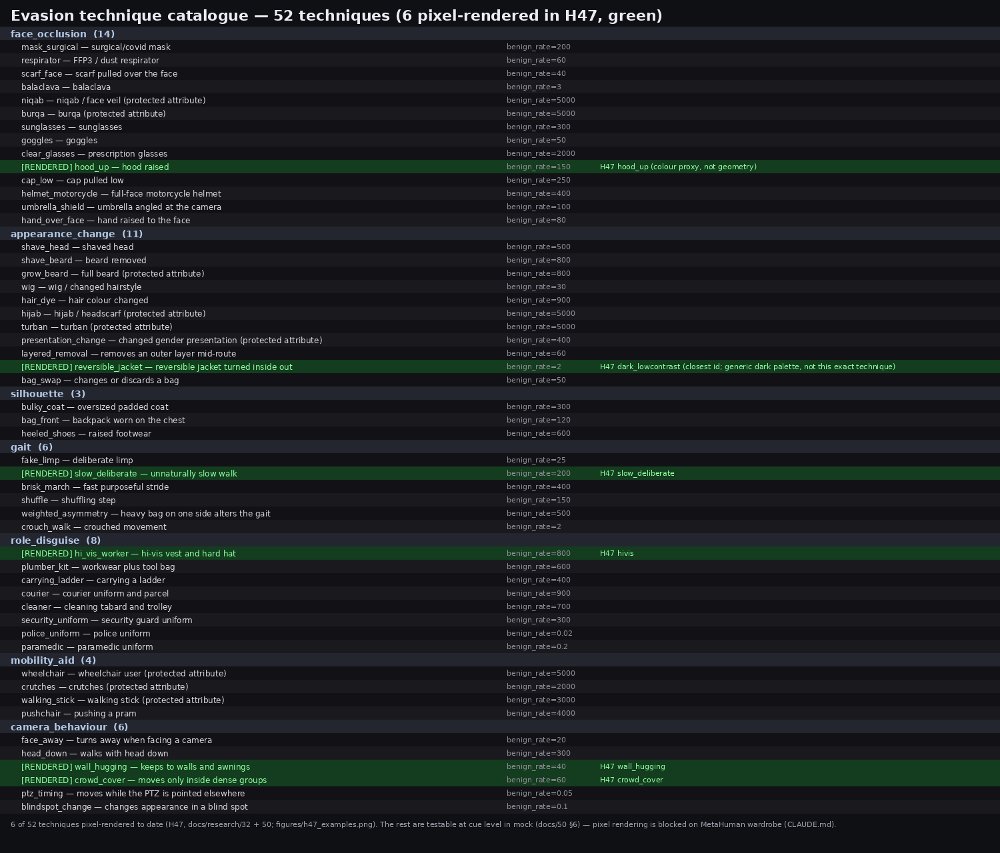
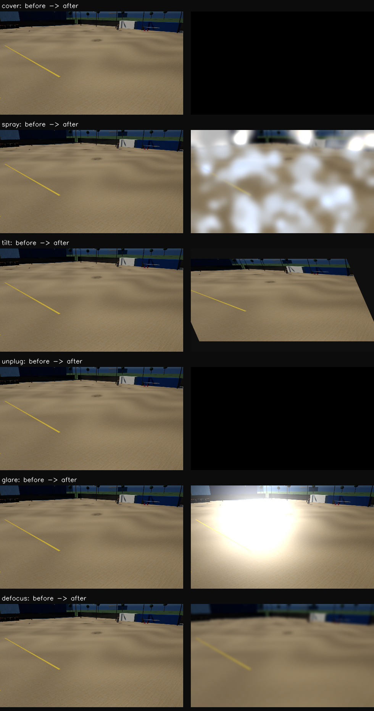

# cctv-security-simulation (SurvSim)

Photorealistic multi-camera, multi-person **CCTV security simulator** for developing and
evaluating video analytics (detection, tracking, multi-camera re-identification,
behaviour/intent, degraded imagery, multi-sensor fusion) against ground truth that real
CCTV can never provide.

Everything is controlled from **YAML + Python** and is **seeded / reproducible**: people
(body, clothes, gait, intent, runtime appearance changes), cameras (optics, PTZ, tamper,
degradation), environment (time, weather) and ground truth.

The analytics, evaluation harness and experiments live in the companion repo
**cctv-security**, which depends on this package.

## Samples

Ground truth drawn on rendered frames (boxes come from rendered masks, so occlusion is honest):




Same scenario, day vs night:



Camera tamper, and image-to-ground homography:




Procedurally generated sites (office, transit, perimeter, retail street, car park, event plaza; 3 seeds each):




Behaviour, evasion and tamper catalogues:





## Quick start
```bash
python3.11 -m venv .venv && source .venv/bin/activate
pip install -e ".[dev]"
pytest -q -n auto
survsim validate configs/scenarios/smoke_mock.yaml
survsim run configs/scenarios/smoke_mock.yaml --out out/run
survsim rig configs/scenarios/disguise_and_tamper.yaml   # coverage, blind spots
```

## Layout
| Path | Content |
|---|---|
| `survsim/core`, `director`, `generator` | models, behaviours, planner, population, camera director, site generator |
| `survsim/backends` | `mock` (pure Python, no GPU) and `unreal` (UnrealCV+ / editor) |
| `survsim/gt`, `sensors`, `realism` | ground-truth writers, degradation/RF/audio/thermal, realism stats |
| `survsim/export`, `scripts/ue` | Unreal scene/character export and editor jobs |
| `configs/` | scenarios, cameras, environments, people |
| `docs/` | design docs 01-12 (architecture, behaviour catalogue, GT format, engine notes) |

See `CLAUDE.md` for the project principles and licensing notes (CC0 character stack by default).

## Licence
GNU Affero General Public License v3.0 or later. See [LICENSE](LICENSE).
